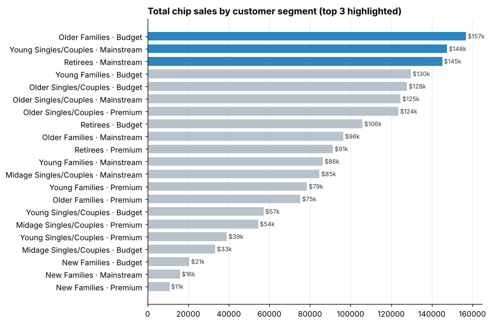
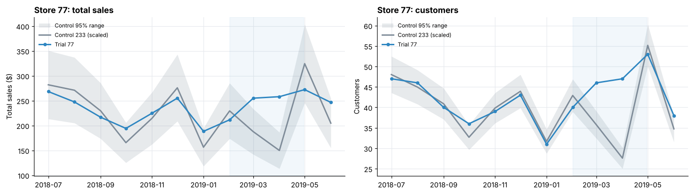

# Quantium Retail Analytics: Chip Category and Store Trial

This is my work for the **Quantium Data Analytics Virtual Experience** on Forage, analysing 12 months of supermarket chip transactions (246,740 after cleaning) for a retail client's Category Manager.

**Tools:** Python · pandas · NumPy · SciPy · matplotlib · Jupyter

## Task 1: Who buys chips?

[`notebooks/Task-1.ipynb`](notebooks/Task-1.ipynb)

**Cleaning**
- Converted Excel serial dates.
- Removed 18,094 salsa transactions, which are outside the chip category.
- Removed one bulk buyer who bought 200 packs at a time.
- Extracted pack size, and normalised brand names (for example, `Dorito` / `Doritos` became one brand).
- Merged in customer segments; every transaction matched.

**Findings**
- **Budget older families** are the largest segment by sales because each one buys about 9 packs a year, roughly double the rate of young singles/couples.
- **Mainstream young singles/couples** and **Mainstream retirees** drive sales through sheer numbers of customers.
- **Mainstream young and mid-age singles/couples pay more per pack** ($4.04 vs $3.71). A Welch t-test confirms the difference is significant (p < 0.001), which is consistent with impulse buying.
- That segment is **about 20% more likely** to buy Tyrrells, Twisties, Doritos, Kettle and Pringles, and about half as likely to buy Woolworths own brand.



## Task 2: Did the store trial work?

[`notebooks/Task-2.ipynb`](notebooks/Task-2.ipynb)

A new layout was trialled in stores 77, 86 and 88 from February to April 2019. For each one, I:
1. **Chose a control store** that behaved most like it before the trial, scoring every candidate on correlation and magnitude distance for both sales and customer numbers.
2. **Scaled** the control store to the trial store's size.
3. **Tested** each trial month against the normal pre-trial gap (one-sided t-test, 95% confidence).

| Trial store | Control | Sales uplift | Significant months (sales) | Customer uplift |
|---|---|---|---|---|
| 77 | 233 | +27.8% | Mar, Apr | +25.2% |
| 86 | 155 | +11.6% | Mar | +12.7% |
| 88 | 237 | +14.2% | Mar, Apr | +7.1% |

**Conclusion:** the trial increased sales in all three stores. Stores 77 and 86 grew mainly through **more customers**, and store 88 through **customers buying more often**.



## Repository structure

```
data/         Raw transaction and customer data from the Forage programme
notebooks/    Task-1 (cleaning and customer analysis) and Task-2 (trial assessment)
charts/       Charts exported by the notebooks
```

## Run it yourself

```bash
pip install -r requirements.txt
cd notebooks
jupyter notebook   # run Task-1 first: it creates data/QVI_data.csv for Task-2
```

## Contact

Balihar Singh Sohal · [LinkedIn](https://www.linkedin.com/in/balihar-singh-sohal-88143a2a4/)
